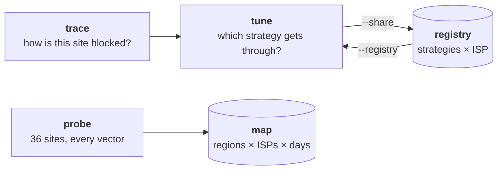

<div align="center">

# Detour Map

**What is blocked in Russia, by which ISP, in which region, and how — and what gets through.**

A crowdsourced block map, a diagnostic tool and a shared database of DPI bypass strategies.

[](https://github.com/ParmesanY/Detour-Map/actions/workflows/ci.yml)
[](LICENSE)
[](#data-and-licenses)

[**Open the map**](https://detour-map-collector.detour-map-collector.workers.dev) ·
[Mirror on GitHub Pages](https://parmesany.github.io/Detour-Map/) ·
[По-русски](README.ru.md)

</div>

---

Most block lists say *that* a site is blocked. Detour Map measures *how*: a DNS stub, a dead IP address, DPI cutting
the TLS handshake by site name (SNI), the "16 KB freeze" on foreign hosting, a dropped QUIC, throttling. Then it goes one
step further: it finds a bypass strategy that works on your ISP, and shares it, so the next person on the same ISP
gets an answer in seconds instead of minutes of trial and error.

It is part of the [Detour](https://github.com/ParmesanY/Detour) family: the Detour client for Windows measures for the
map (opt-in) and uses the probe library from this repository.

## Three tools, one loop



| | What it does | Where |
|---|---|---|
| **probe** | Measures ~36 sites and hosts (DNS, TCP, TLS/SNI, 16 KB freeze, QUIC, throttling) and sends an anonymous report to the map | `detour-probe`, Detour |
| **trace** | Takes one site apart: which vector blocks it and what helps, as a colored report, JSON or Markdown for a bug report | `detour-probe trace <site>` |
| **tune** | Picks a working [zapret](https://github.com/bol-van/zapret) (winws) or [ByeDPI](https://github.com/hufrea/byedpi) strategy, guided by the trace | `detour-probe tune <site>` |
| **registry** | Which strategies work for which ISP; every hint is re-checked locally before it is used | `GET /v1/strategies` |
| **map** | The public site: shares of blocked probes by region, ISP and day, plus other open sources | [the map](https://detour-map-collector.detour-map-collector.workers.dev) |

## Quick start

You need the [.NET 10 SDK](https://dotnet.microsoft.com/download). Nothing is sent anywhere unless you ask for it.

```sh
# How exactly is a site blocked, and what helps?
dotnet run --project probe/Detour.NetProbe.Cli -- trace x.com

# The same as Markdown, ready for a GitHub issue or a forum post
dotnet run --project probe/Detour.NetProbe.Cli -- trace rutracker.org --markdown

# Find a zapret strategy (run as administrator; stop any running zapret first)
dotnet run --project probe/Detour.NetProbe.Cli -- tune rutracker.org --winws C:\zapret\bin\winws.exe

# ByeDPI needs no admin rights; --registry tries what worked for others on your ISP first
dotnet run --project probe/Detour.NetProbe.Cli -- tune x.com --byedpi C:\byedpi\ciadpi.exe \
    --registry https://detour-map-collector.detour-map-collector.workers.dev --share

# Measure every target and send the report to the map
dotnet run --project probe/Detour.NetProbe.Cli -- --net home --send https://detour-map-collector.detour-map-collector.workers.dev
```

<details>
<summary><b>Example: <code>trace</code> and <code>tune</code> on a site blocked by SNI</b></summary>

```text
trace: DPI by site name (SNI)

  This starts winws.exe (the WinDivert driver) up to 10 times, for TCP 443 to rutracker.org only,
  on network card "Ethernet". Other traffic is untouched; winws is stopped at the end.
  Continue? [y/N] y

  strategy                 result   time
  no bypass                0/2      timeout
  fake-ts                  2/2      620 ms

  Note: DPI reassembled the split ClientHello in the trace: plain splits are skipped, fakes go first.

  Best: fake-ts
  --filter-tcp=443 --hostlist-domains=rutracker.org --dpi-desync=fake --dpi-desync-repeats=6 --dpi-desync-fooling=ts --dpi-desync-fake-tls="%BIN%tls_clienthello_www_google_com.bin"
```

</details>

## What gets measured

| Vector | How it is told apart | What helps |
|---|---|---|
| DNS substitution | The ISP's resolver vs DoH (1.1.1.1, 8.8.8.8): a stub, NXDOMAIN or other addresses | Encrypted DNS |
| IP block | TCP to the real address fails, with any name | VPN |
| DPI by name (SNI) | TLS with the real name is cut, the same address with a neutral name works, and the name is cut on an unrelated server too | zapret, ByeDPI, VPN |
| Segment reassembly | A ClientHello split into TCP segments gets through or not | Picks between split and fake strategies |
| 16 KB freeze | The transfer stops after ~16 KB on foreign hosting (Cloudflare, Hetzner, OVH…) | Sometimes fake+split, always a VPN |
| Stall, throttling | Silence after the handshake; data far below normal speed | Depends |
| QUIC | A QUIC handshake to the same address | Falling back to TCP |
| Block page | Plain HTTP answers with the ISP's stub or HTTP 451 | HTTPS |

Every connection is bound to the physical network card, so a running VPN doesn't hide the ISP. A running DPI bypass
would, so reports made with one are refused.

## Privacy

- **No IP addresses are stored.** The collector uses the address only to learn the ISP (ASN) and region from
  Cloudflare, and to make a pseudonym for the day: an HMAC with a random salt that is deleted when the day ends.
  Pseudonyms are cleared after two days, raw reports after 30.
- **Nothing is shown alone.** A region, an ISP or a strategy appears only after at least 3 different people reported it.
- **No site names you didn't choose to share.** Tune results carry a site only if it is in the public
  [target list](spec/targets.json).
- **The site loads nothing from third parties**: no analytics, fonts, map tiles or CDNs, with a strict CSP.

## Data and licenses

| | License |
|---|---|
| Code | [MIT](LICENSE) |
| The map's aggregated data (`/v1/*`) | [CC BY 4.0](https://creativecommons.org/licenses/by/4.0/) |
| OONI layer on the site ([OONI](https://ooni.org/) Web Connectivity, last 7 days) | [CC BY-NC-SA 4.0](https://github.com/ooni/license), shown separately and attributed |
| RKN register status ([antifilter.download](https://antifilter.download/) export) | facts from a public register |
| Event timeline ([spec/events.json](spec/events.json)) | each event links its source |
| Region borders ([Natural Earth](https://www.naturalearthdata.com/)) | public domain |

Other sources are never mixed into our verdicts: each has its own method, so each is its own layer.

## API

Everything is open and CORS-enabled.

| Endpoint | |
|---|---|
| `GET /v1/targets` | What is measured |
| `GET /v1/summary?days=1\|7\|30&net=home\|mobile` | Every target, whole country |
| `GET /v1/map?target=youtube` | One target by region |
| `GET /v1/isps?target=youtube&region=MOW` | One target by ISP |
| `GET /v1/history?target=youtube&asn=12389` | One target by day |
| `GET /v1/strategies?engine=winws\|byedpi[&asn=N][&target=ID]` | Strategies that work for an ISP (the asking connection's ISP by default) |
| `POST /v1/report`, `POST /v1/strategies` | Reports from the probe and from tune |

## Repository

```text
probe/Detour.NetProbe         measurement library: probe, trace, tune, registry client (shared with Detour)
probe/Detour.NetProbe.Cli     detour-probe (native AOT)
probe/Detour.NetProbe.Tests   TUnit tests
collector/                    Cloudflare Worker + D1: ingest, aggregates, API, static site
site/public                   the map: plain HTML/CSS/JS, pre-projected SVG regions
site/tools                    region geometry builder, other-sources fetcher
spec/                         targets, events, verdict and strategy-key cases shared by C# and TypeScript
docs/PLAN.md                  design and roadmap (in Russian)
```

<details>
<summary><b>Run the collector and the site locally</b></summary>

```sh
cd collector
npm install
npm run db:migrate:local
npm run seed:local     # invented numbers, local database only
npm run dev            # http://localhost:8787
npm test               # vitest in workerd against a local D1
```

Deploying your own instance: `npx wrangler login --device`, `npx wrangler d1 create detour-map` (put the id into
`wrangler.jsonc`), `npx wrangler d1 migrations apply detour-map --remote`, `npx wrangler deploy`.

</details>

## Status

The probe, trace, tune, the registry and the map work; the instance above is a test stand. Next: Detour applies
strategies from the registry on its own, other countries' target lists, a Linux build for routers. See
[docs/PLAN.md](docs/PLAN.md).

Detour Map is a measurement tool. It reports what networks do; it doesn't run anything on your computer unless you
ask (`tune` asks again before it starts winws).
