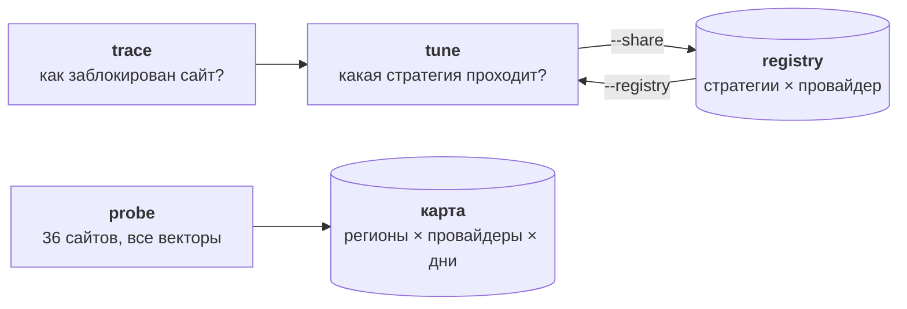

<div align="center">

# Detour Map

**Что блокируют в России, у какого провайдера, в каком регионе и как — и что проходит.**

Народная карта блокировок, инструмент диагностики и общая база стратегий обхода DPI.

[](https://github.com/ParmesanY/detour-map/actions/workflows/ci.yml)
[](LICENSE)
[](#данные-и-лицензии)

[**Открыть карту**](https://detour-map-collector.detour-map-collector.workers.dev) ·
[Зеркало на GitHub Pages](https://parmesany.github.io/detour-map/) ·
[English](README.md)

</div>

---

Списки блокировок говорят, *что* сайт заблокирован. Detour Map меряет, *как*: заглушка в DNS, мёртвый IP-адрес,
DPI, рвущий TLS по имени сайта (SNI), «заморозка 16 КБ» на зарубежных хостингах, сброшенный QUIC, замедление.
И идёт на шаг дальше: подбирает стратегию обхода, которая работает у вашего провайдера, и делится ею — следующий
человек у того же провайдера получает ответ за секунды, а не после минут перебора.

Проект из семьи [Detour](https://github.com/ParmesanY/Detour): клиент Detour для Windows по желанию присылает замеры
на карту и использует библиотеку зонда из этого репозитория.

## Три инструмента, один круг



| | Что делает | Где |
|---|---|---|
| **probe** | Меряет ~36 сайтов и хостингов (DNS, TCP, TLS/SNI, заморозка 16 КБ, QUIC, замедление) и анонимно отправляет отчёт на карту | `detour-probe`, Detour |
| **trace** | Разбирает один сайт: каким способом блокируют и что поможет; цветной отчёт, JSON или Markdown для баг-репорта | `detour-probe trace <сайт>` |
| **tune** | Подбирает рабочую стратегию [zapret](https://github.com/bol-van/zapret) (winws) или [ByeDPI](https://github.com/hufrea/byedpi) с учётом trace | `detour-probe tune <сайт>` |
| **registry** | Какие стратегии работают у какого провайдера; каждая подсказка перед применением проверяется локально | `GET /v1/strategies` |
| **карта** | Публичный сайт: доля замеров с блокировкой по регионам, провайдерам и дням, плюс другие открытые источники | [карта](https://detour-map-collector.detour-map-collector.workers.dev) |

## Быстрый старт

Нужен [.NET 10 SDK](https://dotnet.microsoft.com/download). Ничего никуда не отправляется, пока вы не попросите.

```sh
# Как именно заблокирован сайт и что поможет?
dotnet run --project probe/Detour.NetProbe.Cli -- trace x.com

# То же в Markdown — сразу для issue на GitHub или форума
dotnet run --project probe/Detour.NetProbe.Cli -- trace rutracker.org --markdown

# Подобрать стратегию zapret (от администратора; запущенный zapret сначала остановить)
dotnet run --project probe/Detour.NetProbe.Cli -- tune rutracker.org --winws C:\zapret\bin\winws.exe

# ByeDPI не нужны права администратора; --registry сначала пробует то, что сработало у других на вашем провайдере
dotnet run --project probe/Detour.NetProbe.Cli -- tune x.com --byedpi C:\byedpi\ciadpi.exe \
    --registry https://detour-map-collector.detour-map-collector.workers.dev --share

# Замерить все цели и отправить отчёт на карту
dotnet run --project probe/Detour.NetProbe.Cli -- --net home --send https://detour-map-collector.detour-map-collector.workers.dev
```

<details>
<summary><b>Пример: <code>trace</code> и <code>tune</code> на сайте, заблокированном по SNI</b></summary>

```text
trace: DPI by site name (SNI)

  This starts winws.exe (the WinDivert driver) up to 10 times, for TCP 443 to rutracker.org only,
  on network card "Ethernet". Other traffic is untouched; winws is stopped at the end.
  Continue? [y/N] y

  strategy                 result   time
  no bypass                0/2      timeout
  fake-ts                  2/2      620 ms

  Note: DPI reassembled the split ClientHello in the trace: plain splits are skipped, fakes go first.

  Best: fake-ts
  --filter-tcp=443 --hostlist-domains=rutracker.org --dpi-desync=fake --dpi-desync-repeats=6 --dpi-desync-fooling=ts --dpi-desync-fake-tls="%BIN%tls_clienthello_www_google_com.bin"
```

</details>

## Что меряется

| Вектор | Как отличается | Что помогает |
|---|---|---|
| Подмена DNS | DNS провайдера против DoH (1.1.1.1, 8.8.8.8): заглушка, «домена нет» или другие адреса | Шифрованный DNS |
| Блок по IP | TCP до настоящего адреса не проходит с любым именем | VPN |
| DPI по имени (SNI) | TLS с настоящим именем рвётся, тот же адрес с нейтральным именем работает, имя режется и на постороннем сервере | zapret, ByeDPI, VPN |
| Сборка сегментов | Проходит ли ClientHello, разрезанный на TCP-сегменты | Выбор между split- и fake-стратегиями |
| Заморозка 16 КБ | Передача замирает после ~16 КБ на зарубежных хостингах (Cloudflare, Hetzner, OVH…) | Иногда fake+split, всегда VPN |
| Тишина, замедление | Ответа нет после рукопожатия; скорость в разы ниже нормы | По ситуации |
| QUIC | Рукопожатие QUIC на тот же адрес | Откат на TCP |
| Страница-заглушка | Обычный HTTP отвечает заглушкой провайдера или HTTP 451 | HTTPS |

Каждое соединение привязано к физической сетевой карте, поэтому запущенный VPN не прячет провайдера. Запущенный
обход DPI прячет, поэтому отчёты, сделанные с ним, не принимаются.

## Приватность

- **IP-адреса не хранятся.** Сборщик использует адрес только чтобы узнать у Cloudflare провайдера (ASN) и регион и
  сделать суточный псевдоним: HMAC со случайной солью, которая удаляется в конце дня. Псевдонимы стираются через два
  дня, сырые отчёты — через 30.
- **Ничего не показывается в одиночку.** Регион, провайдер или стратегия появляются только после отчётов минимум
  трёх разных людей.
- **Никаких имён сайтов, которыми вы не делились.** Результаты tune содержат сайт, только если он есть в публичном
  [списке целей](spec/targets.json).
- **Сайт ничего не грузит у третьих лиц**: ни аналитики, ни шрифтов, ни тайлов карты, ни CDN; строгий CSP.

## Данные и лицензии

| | Лицензия |
|---|---|
| Код | [MIT](LICENSE) |
| Агрегаты карты (`/v1/*`) | [CC BY 4.0](https://creativecommons.org/licenses/by/4.0/) |
| Слой OONI на сайте ([OONI](https://ooni.org/) Web Connectivity, 7 дней) | [CC BY-NC-SA 4.0](https://github.com/ooni/license), отдельно и с указанием источника |
| Есть ли в реестре РКН (выгрузка [antifilter.download](https://antifilter.download/)) | факты из публичного реестра |
| Лента событий ([spec/events.json](spec/events.json)) | у каждого события ссылка на источник |
| Границы регионов ([Natural Earth](https://www.naturalearthdata.com/)) | public domain |

Чужие данные не смешиваются с нашими вердиктами: у каждого источника своя методика, поэтому у каждого свой слой.

## API

Всё открыто, CORS разрешён.

| Адрес | |
|---|---|
| `GET /v1/targets` | Что меряется |
| `GET /v1/summary?days=1\|7\|30&net=home\|mobile` | Все цели, вся страна |
| `GET /v1/map?target=youtube` | Одна цель по регионам |
| `GET /v1/isps?target=youtube&region=MOW` | Одна цель по провайдерам |
| `GET /v1/history?target=youtube&asn=12389` | Одна цель по дням |
| `GET /v1/strategies?engine=winws\|byedpi[&asn=N][&target=ID]` | Стратегии, работающие у провайдера (по умолчанию — у провайдера запроса) |
| `POST /v1/report`, `POST /v1/strategies` | Отчёты зонда и tune |

## Репозиторий

```text
probe/Detour.NetProbe         библиотека замеров: probe, trace, tune, клиент реестра (общая с Detour)
probe/Detour.NetProbe.Cli     detour-probe (native AOT)
probe/Detour.NetProbe.Tests   тесты TUnit
collector/                    Cloudflare Worker + D1: приём, агрегаты, API, статический сайт
site/public                   карта: чистые HTML/CSS/JS, заранее спроецированные SVG-регионы
site/tools                    сборка геометрии регионов, загрузка других источников
spec/                         цели, события, примеры вердиктов и ключей стратегий, общие для C# и TypeScript
docs/PLAN.md                  устройство и планы
```

<details>
<summary><b>Запустить сборщик и сайт локально</b></summary>

```sh
cd collector
npm install
npm run db:migrate:local
npm run seed:local     # выдуманные числа, только локальная база
npm run dev            # http://localhost:8787
npm test               # vitest в workerd на локальной D1
```

Свой экземпляр: `npx wrangler login --device`, `npx wrangler d1 create detour-map` (id — в `wrangler.jsonc`),
`npx wrangler d1 migrations apply detour-map --remote`, `npx wrangler deploy`.

</details>

## Статус

Работают зонд, trace, tune, реестр стратегий и карта; экземпляр по ссылке выше — тестовый стенд. Дальше: Detour сам
применяет стратегии из реестра, списки целей для других стран, сборка для Linux и роутеров. Подробнее —
[docs/PLAN.md](docs/PLAN.md).

Detour Map — инструмент измерений. Он сообщает, что делают сети, и ничего не запускает на компьютере без спроса
(`tune` ещё раз спрашивает перед запуском winws).
